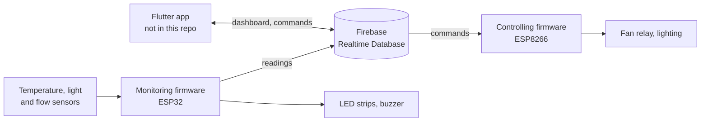

# Mosque Control System

An IoT system for monitoring and controlling a mosque's environment (temperature, lighting, airflow) from a mobile app, using ESP-based firmware and Firebase as the cloud link.

## Architecture

## Components

| Part | Folder | Role |
|------|--------|------|
| Monitoring firmware | `Mosque_Monitoring_Firmware/` | Reads temperature, light and flow sensors, drives LED strips and a buzzer for alerts, uploads readings to Firebase over WiFi |
| Controlling firmware | `Mosque_Controlling_Firmware/` | Receives commands from Firebase and switches the fan (via relay) and lighting |
| Mobile app | not in this repository | Flutter app: live dashboard, remote control, historical charts, notifications, multi-language, ML features |

The Flutter app source is not published in this repository. Its design and features are documented in the files below.

Design and usage notes are in `Mosque_Monitoring_Firmware/` (`Mosque Firmware.docx`, `mobile_documentation.pdf`, `MOSQUES AUTOMATION SYSTEM MOBILE APP REPORT.pdf`).

## Setup

1. Create a Firebase project and enable the Realtime Database.
2. Firmware: in each firmware folder, copy `secrets.example.h` to `secrets.h` (git-ignored) and fill in the Wi-Fi network, the Firebase API key and database URL, and the email and password of a Firebase Authentication user created for the device. Set pin numbers in `configs.h`. Open the `.ino` in the Arduino IDE, install the libraries below, and flash each board.
3. App: point the Flutter app at the same Firebase project (add its config files), then `flutter pub get` and `flutter run`.

| Sketch | Board | Libraries (versions CI compiles with) |
|---|---|---|
| `Mosque_Controlling_Firmware` | ESP8266 (NodeMCU 1.0), core 3.1.2 | Firebase Arduino Client Library for ESP8266 and ESP32 4.4.14 |
| `Mosque_Monitoring_Firmware` | ESP32, core 3.0.4 | FirebaseClient 1.3.9, ESP32Servo, Adafruit NeoPixel |

Never commit real Wi-Fi or Firebase credentials: they belong in `secrets.h` only.

## CI

GitHub Actions compiles both sketches (with the placeholder credentials) on every pull request and on pushes to `main`. There are no unit tests for the firmware.

## Safety

Mains-powered parts (fan, lighting relays) must follow local electrical standards and be installed by a qualified electrician.

## Security notes

- Credentials live in a git-ignored `secrets.h`. Use a dedicated Firebase Authentication user for the boards, not a personal account, and Realtime Database rules that limit that user to the mosque's paths.
- See [SECURITY.md](SECURITY.md) to report a vulnerability.

## License and author

[MIT](LICENSE). Built by Ahmed Ibrahim Hussien ([a-3isa](https://github.com/a-3isa)).
